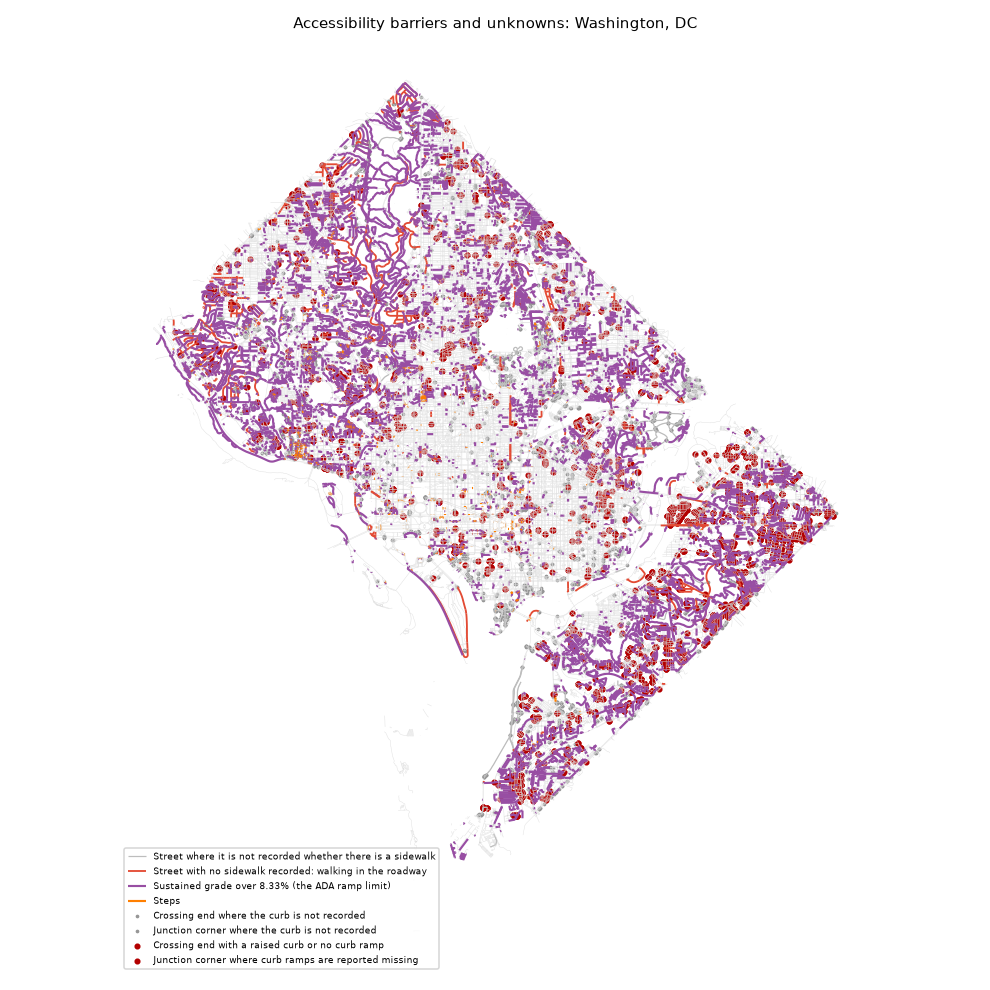

# Accessibility barriers: Washington, DC

_Generated by `pf barriers` from the enriched graph. Do not edit by hand._

A **barrier** is what a named source recorded on the given date; an **unknown** is a place nobody has recorded. Nothing here certifies a place as accessible. Slope is unknown wherever no elevation model is loaded, so no steep segment can appear before one is.

Walkable network inside the line: 4,766 km.

| type | kind | what | count | km | verified_pct |
|---|---|---|---|---|---|
| curb_barrier | barrier | Crossing end with a raised curb or no curb ramp | 1,281 |  | 100.0 |
| junction_curb_barrier | barrier | Junction corner where curb ramps are reported missing | 1,107 |  | 0.0 |
| ramp_fails_check | barrier | Curb ramp that fails its survey (too steep, no landing or damaged) | 0 |  |  |
| ramp_no_tactile_pad | barrier | Curb ramp with no working tactile warning pad | 0 |  |  |
| steep | barrier | Sustained grade over 8.33% (the ADA ramp limit) | 12,440 | 849.7 | 69.8 |
| steps | barrier | Steps | 1,689 | 12.5 | 100.0 |
| no_sidewalk | barrier | Street with no sidewalk recorded: walking in the roadway | 1,429 | 112.5 | 100.0 |
| sidewalk_poor_condition | barrier | Sidewalk with a survey condition index under 40 of 100 | 0 |  |  |
| sidewalk_narrow | barrier | Sidewalk recorded narrower than 1.2 m (4 ft) | 0 |  |  |
| curb_unknown | unknown | Crossing end where the curb is not recorded | 2,576 |  | 0.0 |
| junction_curb_unknown | unknown | Junction corner where the curb is not recorded | 658 |  | 0.0 |
| sidewalk_unknown | unknown | Street where it is not recorded whether there is a sidewalk | 1,658 | 57.0 | 0.0 |

## By ward (most unknowns per km first)

Tracts with at least 1 km of walkable network inside the line. Full table: [`barriers_by_tract.csv`](barriers_by_tract.csv).

| WARD | barriers | unknowns | network_km | barriers_per_km | unknowns_per_km |
|---|---|---|---|---|---|
| 8.0 | 1888.0 | 885.0 | 483.1 | 3.91 | 1.83 |
| 7.0 | 2849.0 | 980.0 | 611.2 | 4.66 | 1.6 |
| 5.0 | 2814.0 | 1111.0 | 821.2 | 3.43 | 1.35 |
| 6.0 | 896.0 | 486.0 | 533.3 | 1.68 | 0.91 |
| 3.0 | 4000.0 | 523.0 | 740.7 | 5.4 | 0.71 |
| 2.0 | 2299.0 | 389.0 | 588.4 | 3.91 | 0.66 |
| 4.0 | 2459.0 | 423.0 | 718.6 | 3.42 | 0.59 |
| 1.0 | 741.0 | 95.0 | 276.7 | 2.68 | 0.34 |

