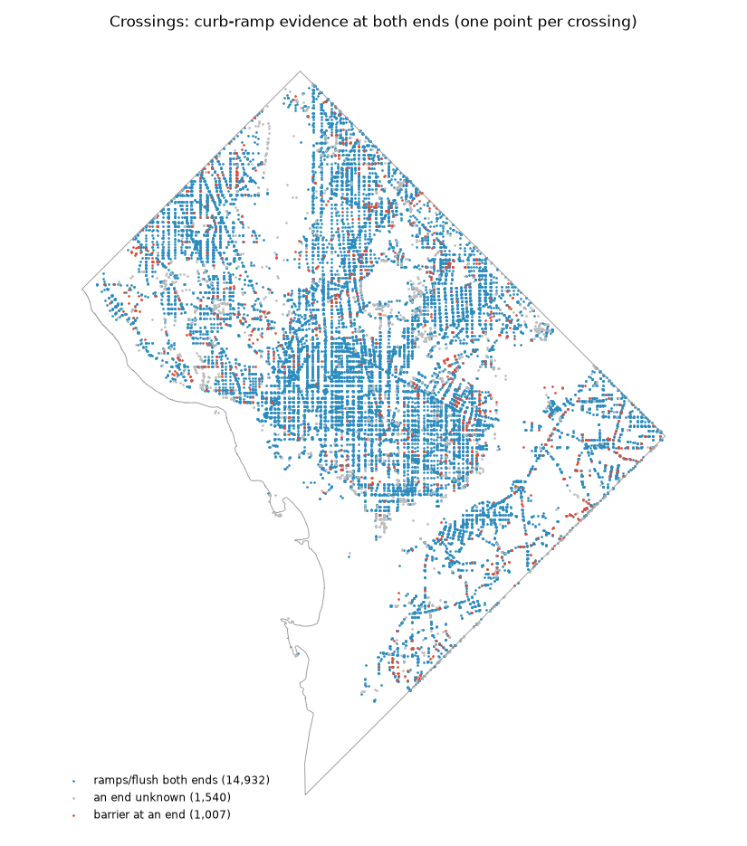
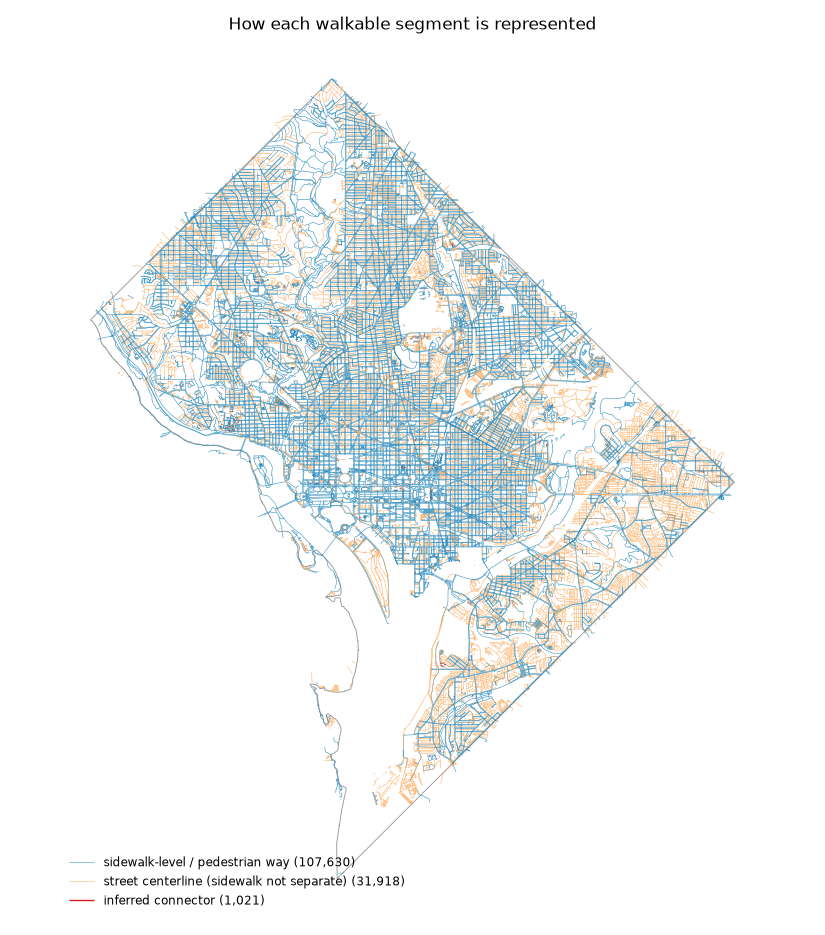
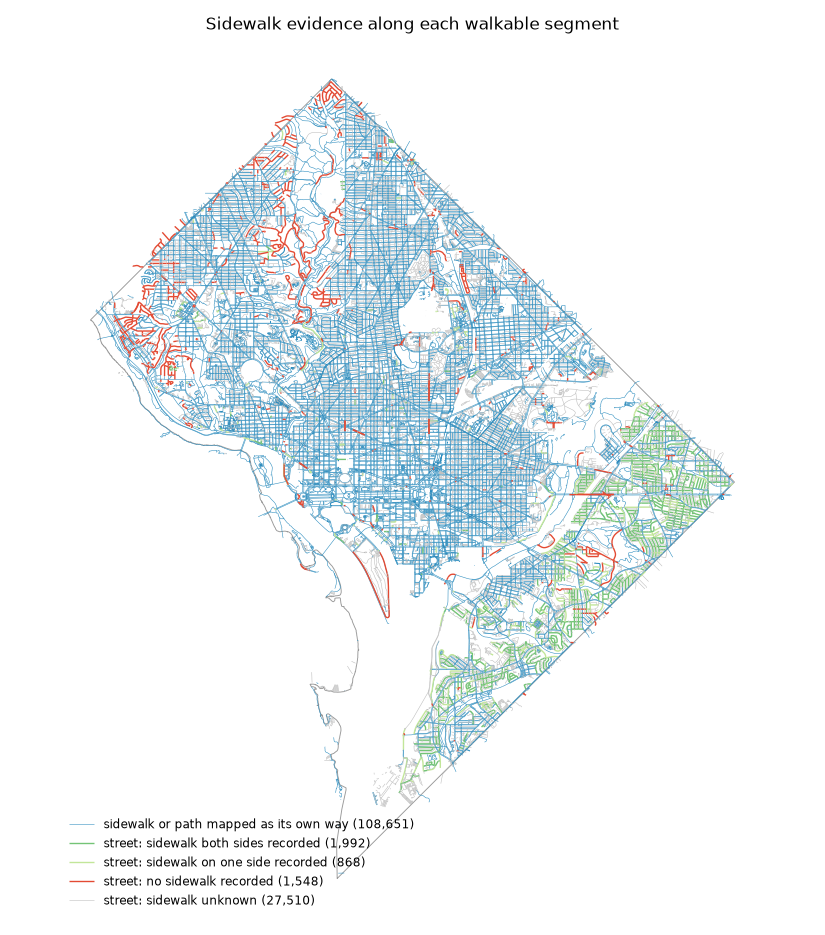
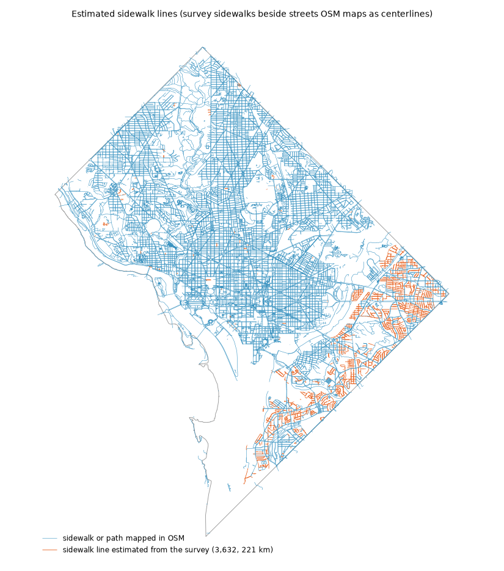

# Phase 0 — Data coverage report: Washington, DC

_Generated by `pf coverage` from the graph built on OSM extract dated Sun, 04 Oct 2026 06:09:58 GMT. Do not edit by hand._

Sources beyond OSM and the boundary: planimetrics = `sidewalks_2021`; roadway = `roadway_block`; signals = `traffic_signals`; ramps = `sidewalk_ramps_2010`; project_sidewalk = `project_sidewalk_dc`; dtm = `dtm_2024`; report_districts = `wards_2022`. An attribute with no source stays unknown; absence of a record counts as evidence only where an inventory covers the place (planimetric: None, signals: None).

Status meanings: **verified** = directly observed by a source (incl. confirmed absence in an inventory comprehensive for that place); **inferred** = produced by a documented heuristic; **unknown** = no evidence. Unknown is never treated as favorable.

## Network

- Walkable edges: **140,569**, nodes: **106,975**
- Largest connected component holds **97.5%** of walkable length (595 components in total; the rest are mostly private-lot service roads)
- Length by representation (km): {'inferred_connector': 4.3, 'pedestrian_way': 3298.3, 'street_centerline': 1551.5} — sidewalk-level share of length: **67.9%**
- Removed-road stubs pruned: 9,677; inferred gap connectors: 1,021 (each disclosed as `inferred_connector`), of which 467 bridge a wider gap across planimetric sidewalk surface
- Pedestrian dead ends left unbridged: 2,322 lie within 15 m of another walkway with no evidence of a connection (near is not connected)

## Accessibility bar (criteria 1, 2, 3, 5; criterion 4 is in crux.md)

Inside the region's line. Fixed on 2026-10-15 before any accessibility source was loaded.

| criterion | value_pct | bar_pct | result | counts |
|---|---|---|---|---|
| 1. Curb evidence at crossing ends, implicit included | 92.4 | 60.0 | passes | 39,305 of 42,539 ends |
| 2. Slope verified, share of walkable length | 82.2 | 80.0 | passes |  |
| 3. Sidewalk evidence, share of walkable length | 74.7 | 60.0 | passes | sidewalk-level ways 68.0%, streets with presence recorded 6.7% (of which a sidewalk on at least one side only: 1.1%) |
| 5. Main component, share of length (whole graph) | 97.5 | 90.0 | passes |  |

- Estimated sidewalk lines (map layer only; the router walks the street centerline, which carries the same survey evidence): 3,632, 221.0 km. See `map_estimated_sidewalks.png`.

## Attribute coverage

| attribute | scope | weighted_by | n | verified | inferred | unknown | top_sources | evidence_year_median | evidence_year_range |
|---|---|---|---|---|---|---|---|---|---|
| crossing_control | crossings | count | 17479 | 72.9 | 27.1 | 0.0 | osm_dc 73%; derived:osm_marked_no_signal_inventory 22%; derived:osm_marked_signalization_not_recorded 4% | 2,026 | 2017–2026 |
| signal_lpi | signalized crossings | count | 4772 | 93.2 | 0.0 | 6.8 | traffic_signals 100% |  |  |
| signal_aps | signalized crossings | count | 4772 | 93.2 | 0.0 | 6.8 | traffic_signals 100% |  |  |
| signal_hawk | signalized crossings | count | 4772 | 93.2 | 0.0 | 6.8 | traffic_signals 100% |  |  |
| signal_all_ped_phase | signalized crossings | count | 4772 | 93.2 | 0.0 | 6.8 | traffic_signals 100% |  |  |
| crossed_lanes | crossings | count | 17479 | 84.5 | 0.0 | 15.5 | roadway_block 100% |  |  |
| crossed_width_m | crossings | count | 17479 | 84.5 | 0.0 | 15.5 | roadway_block 100% |  |  |
| crossed_speed_mph | crossings | count | 17479 | 75.2 | 0.0 | 24.8 | roadway_block 100% |  |  |
| crossed_aadt | crossings | count | 17479 | 33.8 | 0.0 | 66.2 | roadway_block 100% | 2,020 | 2020–2020 |
| kerb_a | crossings | count | 17479 | 92.3 | 0.0 | 7.7 | project_sidewalk_dc 66%; osm_dc 32%; sidewalk_ramps_2010 2% | 2,016 | 2007–2026 |
| kerb_b | crossings | count | 17479 | 92.3 | 0.0 | 7.7 | project_sidewalk_dc 65%; osm_dc 32%; sidewalk_ramps_2010 3% | 2,016 | 2007–2026 |
| ramp_check_a | crossings | count | 17479 | 0.0 | 0.0 | 100 |  |  |  |
| ramp_check_b | crossings | count | 17479 | 0.0 | 0.0 | 100 |  |  |  |
| step_free | all edges | length | 140569 | 0.7 | 99.3 | 0.0 | derived:absent_from_osm_steps_outside_inventory 88%; derived:absent_from_osm_steps_offstreet 9%; osm_dc 1% | 2,026 | 2015–2026 |
| grade_avg_pct | all edges | length | 140569 | 82.0 | 17.3 | 0.6 | dtm_2024 99%; derived:dtm_2024_endpoints 1% | 2,024 | 2024–2024 |
| grade_max_pct | all edges | length | 140569 | 82.0 | 17.3 | 0.6 | dtm_2024 99%; derived:dtm_2024_endpoints 1% | 2,024 | 2024–2024 |
| surface_class | pedestrian ways | length | 107630 | 46.5 | 0.0 | 53.5 | osm_dc 100% | 2,026 | 2026–2026 |
| sidewalk_presence | street centerlines | length | 31918 | 20.9 | 0.0 | 79.1 | sidewalks_2021 55%; osm_dc 45% | 2,021 | 2015–2026 |
| sidewalk_condition | sidewalks | length | 63522 | 0.0 | 0.0 | 100 |  |  |  |
| sidewalk_width_m | sidewalks | length | 63522 | 0.0 | 0.0 | 100 |  |  |  |
| street_lanes | street centerlines | length | 31918 | 26.4 | 0.0 | 73.6 | roadway_block 100% |  |  |
| street_speed_mph | street centerlines | length | 31918 | 23.2 | 0.0 | 76.8 | roadway_block 100% |  |  |

## By ward

| ward | network_km | sidewalk_level_share_pct | crossings | crossings_both_kerbs_known_pct | crossings_control_known_pct | centerline_sidewalk_known_pct | grade_known_pct |
|---|---|---|---|---|---|---|---|
| 1 | 276.7 | 74.7 | 1169 | 96.3 | 100 | 4.5 | 99.3 |
| 2 | 588.4 | 82.6 | 2555 | 94.7 | 99.9 | 9.6 | 98.7 |
| 3 | 740.7 | 71.3 | 2413 | 90.8 | 100 | 25.1 | 99.5 |
| 4 | 718.6 | 70.7 | 2511 | 92.6 | 100 | 13.8 | 99.9 |
| 5 | 821.2 | 68.1 | 3074 | 86.8 | 100 | 6.7 | 99.7 |
| 6 | 533.3 | 78.0 | 2338 | 89.5 | 100 | 8.2 | 98.7 |
| 7 | 611.2 | 47.3 | 1952 | 92.8 | 100 | 41.6 | 99.9 |
| 8 | 483.1 | 53.0 | 1442 | 89.2 | 100 | 27.5 | 99.7 |

## Each attribute by ward: % of its scope with any evidence (verified or inferred)

Verified / inferred / unknown shares per ward are in `coverage_attributes_by_ward.csv`.

| attribute | ward 1 | ward 2 | ward 3 | ward 4 | ward 5 | ward 6 | ward 7 | ward 8 |
|---|---|---|---|---|---|---|---|---|
| crossing_control | 100 | 99.9 | 100 | 100 | 100 | 100 | 100 | 100 |
| signal_lpi | 95.1 | 92.0 | 95.7 | 96.3 | 91.4 | 90.6 | 96.6 | 94.7 |
| signal_aps | 95.1 | 92.0 | 95.7 | 96.3 | 91.4 | 90.6 | 96.6 | 94.7 |
| signal_hawk | 95.1 | 92.0 | 95.7 | 96.3 | 91.4 | 90.6 | 96.6 | 94.7 |
| signal_all_ped_phase | 95.1 | 92.0 | 95.7 | 96.3 | 91.4 | 90.6 | 96.6 | 94.7 |
| crossed_lanes | 89.1 | 84.2 | 86.9 | 92.0 | 80.4 | 79.1 | 85.6 | 84.3 |
| crossed_width_m | 89.1 | 84.5 | 86.9 | 92.0 | 80.4 | 79.1 | 85.6 | 84.3 |
| crossed_speed_mph | 73.6 | 67.1 | 85.7 | 87.1 | 75.0 | 62.8 | 75.5 | 75.7 |
| crossed_aadt | 41.7 | 51.8 | 25.7 | 28.5 | 27.4 | 41.0 | 29.9 | 30.0 |
| kerb_a | 97.7 | 95.1 | 92.3 | 93.6 | 88.7 | 91.5 | 94.6 | 90.2 |
| kerb_b | 96.7 | 95.4 | 92.4 | 93.7 | 88.0 | 91.4 | 95.1 | 90.6 |
| ramp_check_a | 0.0 | 0.0 | 0.0 | 0.0 | 0.0 | 0.0 | 0.0 | 0.0 |
| ramp_check_b | 0.0 | 0.0 | 0.0 | 0.0 | 0.0 | 0.0 | 0.0 | 0.0 |
| step_free | 100 | 100 | 100 | 100 | 100 | 100 | 100 | 100 |
| grade_avg_pct | 99.3 | 98.7 | 99.5 | 99.9 | 99.7 | 98.7 | 99.9 | 99.7 |
| grade_max_pct | 99.3 | 98.7 | 99.5 | 99.9 | 99.7 | 98.7 | 99.9 | 99.7 |
| surface_class | 69.5 | 64.6 | 75.1 | 31.9 | 21.1 | 42.7 | 24.5 | 47.3 |
| sidewalk_presence | 4.5 | 9.6 | 25.1 | 13.8 | 6.7 | 8.2 | 41.6 | 27.5 |
| sidewalk_condition | 0.0 | 0.0 | 0.0 | 0.0 | 0.0 | 0.0 | 0.0 | 0.0 |
| sidewalk_width_m | 0.0 | 0.0 | 0.0 | 0.0 | 0.0 | 0.0 | 0.0 | 0.0 |
| street_lanes | 9.1 | 17.9 | 26.4 | 19.0 | 14.0 | 14.6 | 48.4 | 34.8 |
| street_speed_mph | 8.2 | 15.1 | 26.0 | 18.5 | 12.4 | 6.1 | 44.4 | 27.5 |

## Cross-source conflicts and quality flags

- `osm_signal_without_signal_inventory_within_40m`: 335
- `osm_unsignalized_with_signal_inventory_within_40m`: 657
- `osm_marked_signalization_not_recorded_with_signal_inventory_within_40m`: 761
- `osm_signal_tags_contradict_each_other`: 163
- `crossings_marked_in_osm_without_planimetric_crosswalk`: 856
- `unmapped_stairs_found_via_planimetrics`: 474
- `kerb_evidence_from_project_sidewalk_pre_2018`: 10,445
- `grade_readings_downgraded_suspect`: 765
- `grade_readings_downgraded_not_repeatable`: 14,988
- `edges_with_grade_separation_masking`: 450
- `implicit_crossing_edge_ends`: 7,924
- `implicit_crossing_ends_with_unknown_kerb`: 701
- `edges_outside_region_inventory_coverage_on_street`: 814
- `grade_readings_discarded_dtm_discontinuity`: 141

## Maps

