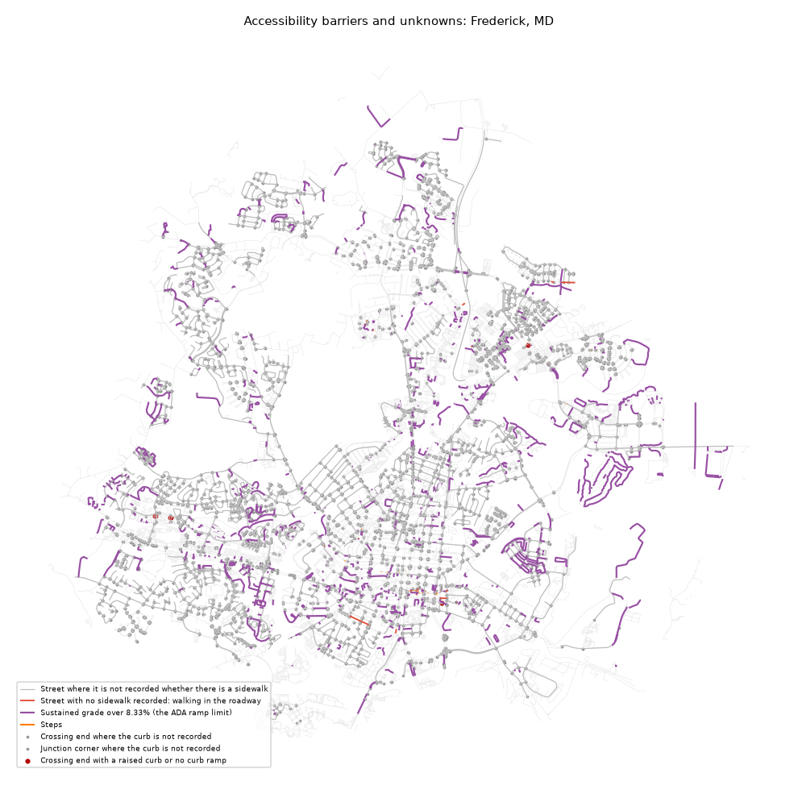

# Accessibility barriers: Frederick, MD

_Generated by `pf barriers` from the enriched graph. Do not edit by hand._

A **barrier** is what a named source recorded on the given date; an **unknown** is a place nobody has recorded. Nothing here certifies a place as accessible. Slope is unknown wherever no elevation model is loaded, so no steep segment can appear before one is.

Walkable network inside the line: 1,200 km.

| type | kind | what | count | km | verified_pct |
|---|---|---|---|---|---|
| curb_barrier | barrier | Crossing end with a raised curb or no curb ramp | 6 |  | 100.0 |
| junction_curb_barrier | barrier | Junction corner where curb ramps are reported missing | 0 |  |  |
| ramp_fails_check | barrier | Curb ramp that fails its survey (too steep, no landing or damaged) | 0 |  |  |
| ramp_no_tactile_pad | barrier | Curb ramp with no working tactile warning pad | 0 |  |  |
| steep | barrier | Sustained grade over 8.33% (the ADA ramp limit) | 1,199 | 92.4 | 76.1 |
| steps | barrier | Steps | 57 | 0.3 | 100.0 |
| no_sidewalk | barrier | Street with no sidewalk recorded: walking in the roadway | 18 | 1.0 | 100.0 |
| sidewalk_poor_condition | barrier | Sidewalk with a survey condition index under 40 of 100 | 0 |  |  |
| sidewalk_narrow | barrier | Sidewalk recorded narrower than 1.2 m (4 ft) | 0 |  |  |
| curb_unknown | unknown | Crossing end where the curb is not recorded | 3,459 |  | 0.0 |
| junction_curb_unknown | unknown | Junction corner where the curb is not recorded | 4,642 |  | 0.0 |
| sidewalk_unknown | unknown | Street where it is not recorded whether there is a sidewalk | 4,342 | 300.6 | 0.0 |

## By census tract (most unknowns per km first)

Tracts with at least 1 km of walkable network inside the line. Full table: [`barriers_by_tract.csv`](barriers_by_tract.csv).

| GEOID | barriers | unknowns | network_km | barriers_per_km | unknowns_per_km |
|---|---|---|---|---|---|
| 24021750100 | 38 | 245 | 15.8 | 2.41 | 15.53 |
| 24021750505 | 90 | 708 | 48.1 | 1.87 | 14.72 |
| 24021751202 | 33 | 858 | 59.5 | 0.55 | 14.42 |
| 24021750504 | 120 | 1,011 | 71.0 | 1.69 | 14.24 |
| 24021750506 | 23 | 676 | 49.2 | 0.47 | 13.73 |
| 24021751203 | 32 | 322 | 25.5 | 1.26 | 12.63 |
| 24021750802 | 57 | 1,230 | 97.4 | 0.58 | 12.62 |
| 24021750508 | 15 | 428 | 38.9 | 0.39 | 11.01 |
| 24021750805 | 43 | 725 | 68.5 | 0.63 | 10.58 |
| 24021750801 | 150 | 750 | 72.3 | 2.07 | 10.37 |
| 24021751301 | 48 | 726 | 76.7 | 0.63 | 9.47 |
| 24021750200 | 39 | 244 | 26.7 | 1.46 | 9.12 |
| 24021750804 | 27 | 323 | 39.1 | 0.69 | 8.26 |
| 24021772200 | 120 | 968 | 119.5 | 1.0 | 8.1 |
| 24021765100 | 49 | 631 | 78.5 | 0.62 | 8.03 |

