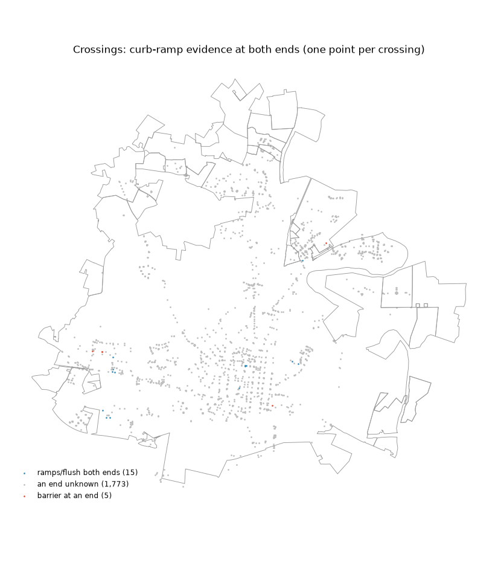
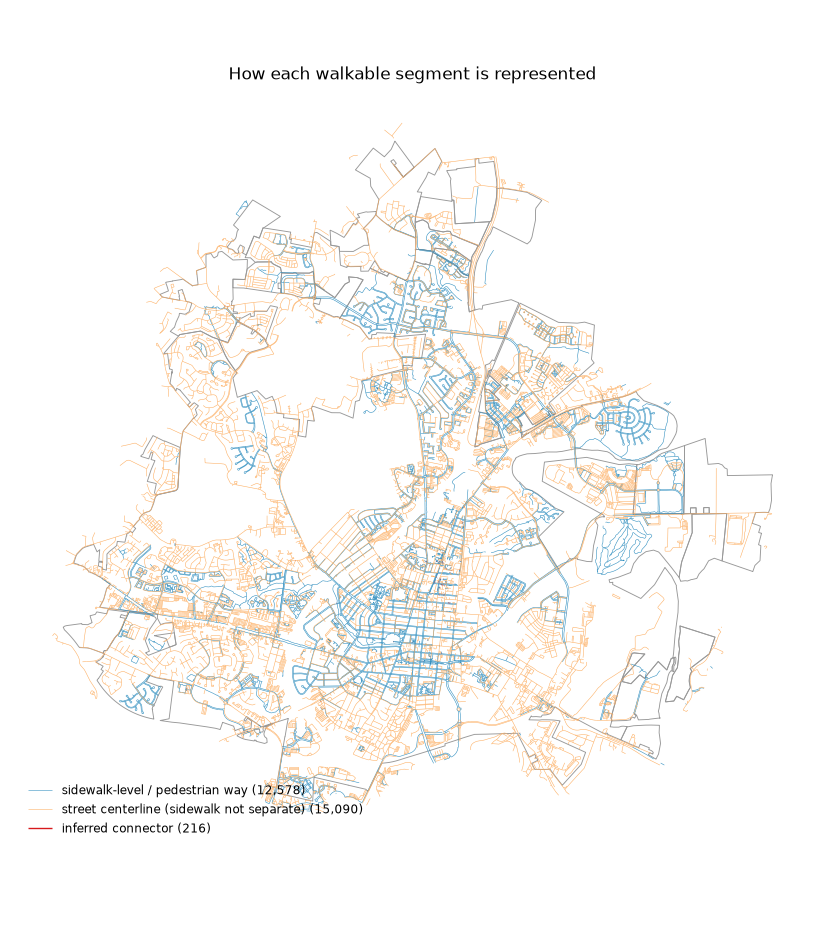
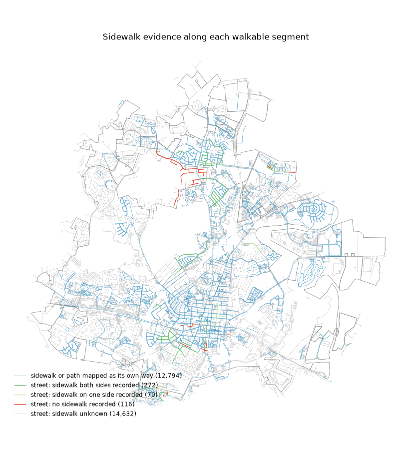

# Phase 0 — Data coverage report: Frederick, MD

_Generated by `pf coverage` from the graph built on OSM extract dated Thu, 15 Oct 2026 03:56:57 GMT. Do not edit by hand._

Sources beyond OSM and the boundary: report_districts = `frederick_tracts`; dtm = `frederick_dtm`; field_checks = `frederick_field_checks`. An attribute with no source stays unknown; absence of a record counts as evidence only where an inventory covers the place (planimetric: None, signals: None).

Status meanings: **verified** = directly observed by a source (incl. confirmed absence in an inventory comprehensive for that place); **inferred** = produced by a documented heuristic; **unknown** = no evidence. Unknown is never treated as favorable.

## Network

- Walkable edges: **27,884**, nodes: **21,062**
- Largest connected component holds **96.9%** of walkable length (151 components in total; the rest are mostly private-lot service roads)
- Length by representation (km): {'inferred_connector': 0.4, 'pedestrian_way': 502.3, 'street_centerline': 835.6} — sidewalk-level share of length: **37.5%**
- Removed-road stubs pruned: 599; inferred gap connectors: 216 (each disclosed as `inferred_connector`), of which 0 bridge a wider gap across planimetric sidewalk surface
- Pedestrian dead ends left unbridged: 1,495 lie within 15 m of another walkway with no evidence of a connection (near is not connected)

## Accessibility bar (criteria 1, 2, 3, 5; criterion 4 is in crux.md)

Inside the region's line. Fixed on 2026-10-15 before any accessibility source was loaded.

| criterion | value_pct | bar_pct | result | counts |
|---|---|---|---|---|
| 1. Curb evidence at crossing ends, implicit included | 17.1 | 60.0 | misses | 1,670 of 9,771 ends |
| 2. Slope verified, share of walkable length | 95.8 | 80.0 | passes |  |
| 3. Sidewalk evidence, share of walkable length | 42.2 | 60.0 | misses | sidewalk-level ways 40.3%, streets with presence recorded 1.9% (of which a sidewalk on at least one side only: 0.0%) |
| 5. Main component, share of length (whole graph) | 96.9 | 90.0 | passes |  |

## Attribute coverage

| attribute | scope | weighted_by | n | verified | inferred | unknown | top_sources | evidence_year_median | evidence_year_range |
|---|---|---|---|---|---|---|---|---|---|
| crossing_control | crossings | count | 1793 | 64.0 | 14.6 | 21.4 | osm_frederick 81%; derived:osm_marked_no_signal_inventory 18%; derived:osm_signal_tags_conflict 0% | 2,026 | 2026–2026 |
| signal_lpi | signalized crossings | count | 34 | 0.0 | 0.0 | 100 |  |  |  |
| signal_aps | signalized crossings | count | 34 | 0.0 | 0.0 | 100 |  |  |  |
| signal_hawk | signalized crossings | count | 34 | 0.0 | 0.0 | 100 |  |  |  |
| signal_all_ped_phase | signalized crossings | count | 34 | 0.0 | 0.0 | 100 |  |  |  |
| crossed_lanes | crossings | count | 1793 | 22.3 | 0.0 | 77.7 | osm_frederick 100% | 2,026 | 2026–2026 |
| crossed_width_m | crossings | count | 1793 | 0.0 | 0.0 | 100 |  |  |  |
| crossed_speed_mph | crossings | count | 1793 | 15.9 | 0.0 | 84.1 | osm_frederick 100% | 2,026 | 2026–2026 |
| crossed_aadt | crossings | count | 1793 | 0.0 | 0.0 | 100 |  |  |  |
| kerb_a | crossings | count | 1793 | 1.3 | 0.0 | 98.7 | osm_frederick 100% | 2,026 | 2026–2026 |
| kerb_b | crossings | count | 1793 | 1.1 | 0.0 | 98.9 | osm_frederick 100% | 2,026 | 2026–2026 |
| ramp_check_a | crossings | count | 1793 | 0.0 | 0.0 | 100 |  |  |  |
| ramp_check_b | crossings | count | 1793 | 0.0 | 0.0 | 100 |  |  |  |
| step_free | all edges | length | 27884 | 0.0 | 100 | 0.0 | derived:absent_from_osm_steps_outside_inventory 79%; derived:absent_from_osm_steps_offstreet 20%; derived:inferred_connector_no_stairs_polygon 1% | 2,026 | 2026–2026 |
| grade_avg_pct | all edges | length | 27884 | 95.5 | 4.5 | 0.1 | frederick_dtm 99%; derived:frederick_dtm_endpoints 1% | 2,021 | 2021–2021 |
| grade_max_pct | all edges | length | 27884 | 95.5 | 4.5 | 0.1 | frederick_dtm 99%; derived:frederick_dtm_endpoints 1% | 2,021 | 2021–2021 |
| surface_class | pedestrian ways | length | 12578 | 17.4 | 0.0 | 82.6 | osm_frederick 100% | 2,026 | 2026–2026 |
| sidewalk_presence | street centerlines | length | 15090 | 3.5 | 0.0 | 96.5 | osm_frederick 100% | 2,026 | 2026–2026 |
| sidewalk_condition | sidewalks | length | 5849 | 0.0 | 0.0 | 100 |  |  |  |
| sidewalk_width_m | sidewalks | length | 5849 | 0.0 | 0.0 | 100 |  |  |  |
| street_lanes | street centerlines | length | 15090 | 11.9 | 0.0 | 88.1 | osm_frederick 100% | 2,026 | 2026–2026 |
| street_speed_mph | street centerlines | length | 15090 | 10.7 | 0.0 | 89.3 | osm_frederick 100% | 2,026 | 2026–2026 |

## By census tract

| ward | network_km | sidewalk_level_share_pct | crossings | crossings_both_kerbs_known_pct | crossings_control_known_pct | centerline_sidewalk_known_pct | grade_known_pct |
|---|---|---|---|---|---|---|---|
| 24021750100 | 15.8 | 50.4 | 64 | 4.7 | 96.9 | 3.6 | 100 |
| 24021750200 | 26.7 | 63.9 | 87 | 1.1 | 100 | 12.4 | 99.1 |
| 24021750300 | 16.9 | 69.5 | 42 | 0.0 | 90.5 | 10.4 | 100 |
| 24021750504 | 71.0 | 38.0 | 113 | 0.0 | 88.5 | 0.0 | 99.9 |
| 24021750505 | 48.1 | 24.8 | 48 | 0.0 | 75.0 | 0.0 | 100 |
| 24021750506 | 49.2 | 30.3 | 92 | 3.3 | 96.7 | 0.0 | 100 |
| 24021750507 | 25.8 | 30.8 | 24 | 4.2 | 83.3 | 0.0 | 100 |
| 24021750508 | 38.9 | 32.3 | 69 | 5.8 | 66.7 | 0.0 | 100 |
| 24021750600 | 70.7 | 65.8 | 180 | 1.1 | 92.2 | 4.9 | 99.9 |
| 24021750701 | 101.2 | 50.8 | 140 | 0.0 | 35.7 | 17.4 | 100 |
| 24021750702 | 43.2 | 39.4 | 51 | 0.0 | 78.4 | 11.2 | 100 |
| 24021750801 | 72.3 | 45.5 | 108 | 0.0 | 71.3 | 0.0 | 100 |
| 24021750802 | 97.4 | 33.3 | 152 | 0.7 | 92.8 | 2.9 | 100 |
| 24021750804 | 39.1 | 45.4 | 73 | 2.7 | 98.6 | 0.0 | 100 |
| 24021750805 | 68.5 | 52.5 | 165 | 0.0 | 58.8 | 2.4 | 100 |
| 24021751002 | 1.6 | 42.2 | 1 | 0.0 | 0.0 | 0.0 | 100 |
| 24021751003 | 53.4 | 23.9 | 15 | 0.0 | 80.0 | 4.7 | 100 |
| 24021751004 | 5.6 | 14.0 | 5 | 0.0 | 40.0 | 4.1 | 99.9 |
| 24021751201 | 62.1 | 40.0 | 76 | 0.0 | 73.7 | 12.0 | 100 |
| 24021751202 | 59.5 | 22.4 | 62 | 0.0 | 96.8 | 0.0 | 99.9 |
| 24021751203 | 25.5 | 2.9 | 5 | 0.0 | 80.0 | 0.0 | 100 |
| 24021751301 | 76.7 | 25.4 | 47 | 0.0 | 6.4 | 0.0 | 100 |
| 24021751302 | 0.8 | 0.0 | 0 |  |  | 0.0 | 100 |
| 24021751701 | 44.3 | 32.7 | 36 | 0.0 | 100 | 0.0 | 100 |
| 24021751902 | 1.3 | 32.8 | 0 |  |  | 0.0 | 100 |
| 24021751904 | 0.2 | 0.0 | 0 |  |  | 0.0 | 100 |
| 24021752602 | 0.8 | 0.0 | 0 |  |  | 0.0 | 100 |
| 24021765100 | 78.5 | 33.4 | 72 | 0.0 | 81.9 | 10.3 | 100 |
| 24021772200 | 119.5 | 27.8 | 111 | 0.0 | 91.9 | 0.3 | 99.7 |
| 24021775600 | 23.6 | 42.4 | 1 | 0.0 | 0.0 | 0.0 | 100 |

## Each attribute by census tract: % of its scope with any evidence (verified or inferred)

Verified / inferred / unknown shares per census tract are in `coverage_attributes_by_census tract.csv`.

| attribute | census tract 24021750100 | census tract 24021750200 | census tract 24021750300 | census tract 24021750504 | census tract 24021750505 | census tract 24021750506 | census tract 24021750507 | census tract 24021750508 | census tract 24021750600 | census tract 24021750701 | census tract 24021750702 | census tract 24021750801 | census tract 24021750802 | census tract 24021750804 | census tract 24021750805 | census tract 24021751002 | census tract 24021751003 | census tract 24021751004 | census tract 24021751201 | census tract 24021751202 | census tract 24021751203 | census tract 24021751301 | census tract 24021751302 | census tract 24021751701 | census tract 24021751902 | census tract 24021751904 | census tract 24021752602 | census tract 24021765100 | census tract 24021772200 | census tract 24021775600 |
|---|---|---|---|---|---|---|---|---|---|---|---|---|---|---|---|---|---|---|---|---|---|---|---|---|---|---|---|---|---|---|
| crossing_control | 96.9 | 100 | 90.5 | 88.5 | 75.0 | 96.7 | 83.3 | 66.7 | 92.2 | 35.7 | 78.4 | 71.3 | 92.8 | 98.6 | 58.8 | 0.0 | 80.0 | 40.0 | 73.7 | 96.8 | 80.0 | 6.4 | 100 | 100 | 100 | 100 | 100 | 81.9 | 91.9 | 0.0 |
| signal_lpi | 100 | 0.0 | 100 | 0.0 | 0.0 | 0.0 | 0.0 | 100 | 0.0 | 0.0 | 100 | 100 | 0.0 | 100 | 100 | 100 | 0.0 | 100 | 0.0 | 100 | 100 | 100 | 100 | 0.0 | 100 | 100 | 100 | 100 | 0.0 | 100 |
| signal_aps | 100 | 0.0 | 100 | 0.0 | 0.0 | 0.0 | 0.0 | 100 | 0.0 | 0.0 | 100 | 100 | 0.0 | 100 | 100 | 100 | 0.0 | 100 | 0.0 | 100 | 100 | 100 | 100 | 0.0 | 100 | 100 | 100 | 100 | 0.0 | 100 |
| signal_hawk | 100 | 0.0 | 100 | 0.0 | 0.0 | 0.0 | 0.0 | 100 | 0.0 | 0.0 | 100 | 100 | 0.0 | 100 | 100 | 100 | 0.0 | 100 | 0.0 | 100 | 100 | 100 | 100 | 0.0 | 100 | 100 | 100 | 100 | 0.0 | 100 |
| signal_all_ped_phase | 100 | 0.0 | 100 | 0.0 | 0.0 | 0.0 | 0.0 | 100 | 0.0 | 0.0 | 100 | 100 | 0.0 | 100 | 100 | 100 | 0.0 | 100 | 0.0 | 100 | 100 | 100 | 100 | 0.0 | 100 | 100 | 100 | 100 | 0.0 | 100 |
| crossed_lanes | 57.8 | 73.6 | 47.6 | 24.8 | 12.5 | 5.4 | 8.3 | 8.7 | 30.6 | 14.3 | 13.7 | 13.9 | 38.8 | 5.5 | 10.3 | 0.0 | 40.0 | 0.0 | 14.5 | 1.6 | 60.0 | 4.3 | 100 | 38.9 | 100 | 100 | 100 | 23.6 | 27.9 | 0.0 |
| crossed_width_m | 0.0 | 0.0 | 0.0 | 0.0 | 0.0 | 0.0 | 0.0 | 0.0 | 0.0 | 0.0 | 0.0 | 0.0 | 0.0 | 0.0 | 0.0 | 0.0 | 0.0 | 0.0 | 0.0 | 0.0 | 0.0 | 0.0 | 100 | 0.0 | 100 | 100 | 100 | 0.0 | 0.0 | 0.0 |
| crossed_speed_mph | 20.3 | 33.3 | 35.7 | 13.3 | 4.2 | 4.3 | 8.3 | 7.2 | 18.3 | 19.3 | 2.0 | 9.3 | 12.5 | 12.3 | 26.1 | 0.0 | 20.0 | 0.0 | 44.7 | 4.8 | 20.0 | 2.1 | 100 | 5.6 | 100 | 100 | 100 | 16.7 | 27.0 | 0.0 |
| crossed_aadt | 0.0 | 0.0 | 0.0 | 0.0 | 0.0 | 0.0 | 0.0 | 0.0 | 0.0 | 0.0 | 0.0 | 0.0 | 0.0 | 0.0 | 0.0 | 0.0 | 0.0 | 0.0 | 0.0 | 0.0 | 0.0 | 0.0 | 100 | 0.0 | 100 | 100 | 100 | 0.0 | 0.0 | 0.0 |
| kerb_a | 4.7 | 1.1 | 2.4 | 0.9 | 2.1 | 3.3 | 4.2 | 8.7 | 1.7 | 0.0 | 0.0 | 0.0 | 0.7 | 2.7 | 0.0 | 0.0 | 0.0 | 0.0 | 0.0 | 0.0 | 0.0 | 0.0 | 100 | 0.0 | 100 | 100 | 100 | 0.0 | 0.9 | 0.0 |
| kerb_b | 4.7 | 2.3 | 0.0 | 0.0 | 2.1 | 3.3 | 4.2 | 5.8 | 1.1 | 0.0 | 2.0 | 0.0 | 1.3 | 2.7 | 0.0 | 0.0 | 0.0 | 0.0 | 0.0 | 0.0 | 0.0 | 0.0 | 100 | 0.0 | 100 | 100 | 100 | 0.0 | 0.0 | 0.0 |
| ramp_check_a | 0.0 | 0.0 | 0.0 | 0.0 | 0.0 | 0.0 | 0.0 | 0.0 | 0.0 | 0.0 | 0.0 | 0.0 | 0.0 | 0.0 | 0.0 | 0.0 | 0.0 | 0.0 | 0.0 | 0.0 | 0.0 | 0.0 | 100 | 0.0 | 100 | 100 | 100 | 0.0 | 0.0 | 0.0 |
| ramp_check_b | 0.0 | 0.0 | 0.0 | 0.0 | 0.0 | 0.0 | 0.0 | 0.0 | 0.0 | 0.0 | 0.0 | 0.0 | 0.0 | 0.0 | 0.0 | 0.0 | 0.0 | 0.0 | 0.0 | 0.0 | 0.0 | 0.0 | 100 | 0.0 | 100 | 100 | 100 | 0.0 | 0.0 | 0.0 |
| step_free | 100 | 100 | 100 | 100 | 100 | 100 | 100 | 100 | 100 | 100 | 100 | 100 | 100 | 100 | 100 | 100 | 100 | 100 | 100 | 100 | 100 | 100 | 100 | 100 | 100 | 100 | 100 | 100 | 100 | 100 |
| grade_avg_pct | 100 | 99.1 | 100 | 99.9 | 100 | 100 | 100 | 100 | 99.9 | 100 | 100 | 100 | 100 | 100 | 100 | 100 | 100 | 99.9 | 100 | 99.9 | 100 | 100 | 100 | 100 | 100 | 100 | 100 | 100 | 99.7 | 100 |
| grade_max_pct | 100 | 99.1 | 100 | 99.9 | 100 | 100 | 100 | 100 | 99.9 | 100 | 100 | 100 | 100 | 100 | 100 | 100 | 100 | 99.9 | 100 | 99.9 | 100 | 100 | 100 | 100 | 100 | 100 | 100 | 100 | 99.7 | 100 |
| surface_class | 4.6 | 30.0 | 15.9 | 10.6 | 2.7 | 10.1 | 3.0 | 11.7 | 30.0 | 5.3 | 14.7 | 4.7 | 36.0 | 9.1 | 62.3 | 0.0 | 6.4 | 0.0 | 15.9 | 6.2 | 0.0 | 6.6 | 100 | 5.6 | 78.1 | 100 | 100 | 10.9 | 18.6 | 0.0 |
| sidewalk_presence | 3.6 | 12.4 | 10.4 | 0.0 | 0.0 | 0.0 | 0.0 | 0.0 | 4.9 | 17.4 | 11.2 | 0.0 | 2.9 | 0.0 | 2.4 | 0.0 | 4.7 | 4.1 | 12.0 | 0.0 | 0.0 | 0.0 | 0.0 | 0.0 | 0.0 | 0.0 | 0.0 | 10.3 | 0.3 | 0.0 |
| sidewalk_condition | 0.0 | 0.0 | 0.0 | 0.0 | 0.0 | 0.0 | 0.0 | 0.0 | 0.0 | 0.0 | 0.0 | 0.0 | 0.0 | 0.0 | 0.0 | 0.0 | 0.0 | 0.0 | 0.0 | 0.0 | 0.0 | 0.0 | 100 | 0.0 | 0.0 | 100 | 100 | 0.0 | 0.0 | 0.0 |
| sidewalk_width_m | 0.0 | 0.0 | 0.0 | 0.0 | 0.0 | 0.0 | 0.0 | 0.0 | 0.0 | 0.0 | 0.0 | 0.0 | 0.0 | 0.0 | 0.0 | 0.0 | 0.0 | 0.0 | 0.0 | 0.0 | 0.0 | 0.0 | 100 | 0.0 | 0.0 | 100 | 100 | 0.0 | 0.0 | 0.0 |
| street_lanes | 36.5 | 31.7 | 5.4 | 13.1 | 6.2 | 14.6 | 3.0 | 7.8 | 6.8 | 13.6 | 5.9 | 9.8 | 19.2 | 4.7 | 9.8 | 50.1 | 6.1 | 5.2 | 13.6 | 9.0 | 18.5 | 17.4 | 0.0 | 10.4 | 55.5 | 100 | 0.0 | 9.1 | 10.2 | 20.2 |
| street_speed_mph | 11.1 | 8.4 | 2.3 | 7.3 | 2.7 | 8.8 | 12.3 | 13.6 | 3.7 | 13.6 | 0.1 | 11.7 | 7.3 | 13.4 | 12.8 | 0.0 | 11.5 | 1.3 | 11.8 | 8.8 | 14.0 | 17.5 | 0.0 | 5.0 | 0.0 | 100 | 0.0 | 8.5 | 20.4 | 1.4 |

## Cross-source conflicts and quality flags

- `osm_signal_without_signal_inventory_within_40m`: 24
- `osm_unsignalized_with_signal_inventory_within_40m`: 0
- `osm_marked_signalization_not_recorded_with_signal_inventory_within_40m`: 0
- `osm_signal_tags_contradict_each_other`: 2
- `crossings_marked_in_osm_without_planimetric_crosswalk`: n/a (no source records it)
- `unmapped_stairs_found_via_planimetrics`: 0
- `kerb_evidence_from_project_sidewalk_pre_2018`: 0
- `grade_readings_downgraded_suspect`: 101
- `grade_readings_downgraded_not_repeatable`: 714
- `edges_with_grade_separation_masking`: 134
- `implicit_crossing_edge_ends`: 7,267
- `implicit_crossing_ends_with_unknown_kerb`: 5,308
- `edges_outside_region_inventory_coverage_on_street`: 1,675
- `grade_readings_discarded_dtm_discontinuity`: 2

## Maps

