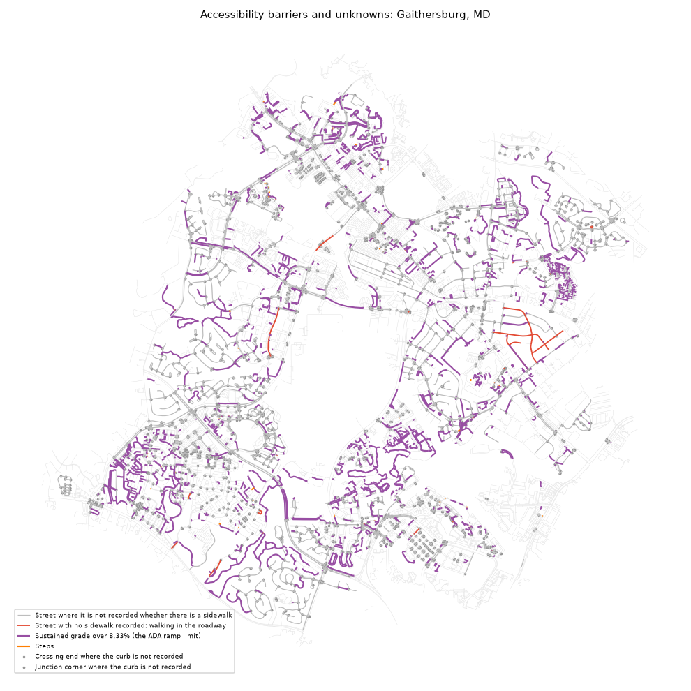

# Accessibility barriers: Gaithersburg, MD

_Generated by `pf barriers` from the enriched graph. Do not edit by hand._

A **barrier** is what a named source recorded on the given date; an **unknown** is a place nobody has recorded. Nothing here certifies a place as accessible. Slope is unknown wherever no elevation model is loaded, so no steep segment can appear before one is.

Walkable network inside the line: 769 km.

| type | kind | what | count | km | verified_pct |
|---|---|---|---|---|---|
| curb_barrier | barrier | Crossing end with a raised curb or no curb ramp | 0 |  |  |
| junction_curb_barrier | barrier | Junction corner where curb ramps are reported missing | 0 |  |  |
| ramp_fails_check | barrier | Curb ramp that fails its survey (too steep, no landing or damaged) | 0 |  |  |
| ramp_no_tactile_pad | barrier | Curb ramp with no working tactile warning pad | 0 |  |  |
| steep | barrier | Sustained grade over 8.33% (the ADA ramp limit) | 1,946 | 113.8 | 71.4 |
| steps | barrier | Steps | 88 | 0.6 | 100.0 |
| no_sidewalk | barrier | Street with no sidewalk recorded: walking in the roadway | 64 | 5.0 | 100.0 |
| sidewalk_poor_condition | barrier | Sidewalk with a survey condition index under 40 of 100 | 0 |  |  |
| sidewalk_narrow | barrier | Sidewalk recorded narrower than 1.2 m (4 ft) | 0 |  |  |
| curb_unknown | unknown | Crossing end where the curb is not recorded | 2,272 |  | 0.0 |
| junction_curb_unknown | unknown | Junction corner where the curb is not recorded | 2,996 |  | 0.0 |
| sidewalk_unknown | unknown | Street where it is not recorded whether there is a sidewalk | 2,760 | 163.5 | 0.0 |

## By census tract (most unknowns per km first)

Tracts with at least 1 km of walkable network inside the line. Full table: [`barriers_by_tract.csv`](barriers_by_tract.csv).

| GEOID | barriers | unknowns | network_km | barriers_per_km | unknowns_per_km |
|---|---|---|---|---|---|
| 24031700720 | 24 | 392 | 22.3 | 1.08 | 17.56 |
| 24031700823 | 47 | 457 | 29.8 | 1.58 | 15.34 |
| 24031700820 | 23 | 225 | 15.5 | 1.48 | 14.52 |
| 24031700829 | 88 | 789 | 60.9 | 1.45 | 12.96 |
| 24031700726 | 289 | 344 | 27.1 | 10.65 | 12.68 |
| 24031700828 | 35 | 275 | 23.0 | 1.52 | 11.95 |
| 24031700731 | 94 | 395 | 34.5 | 2.72 | 11.45 |
| 24031700732 | 90 | 318 | 28.6 | 3.14 | 11.1 |
| 24031700723 | 98 | 633 | 58.3 | 1.68 | 10.86 |
| 24031700733 | 209 | 780 | 89.0 | 2.35 | 8.77 |
| 24031700725 | 34 | 158 | 18.2 | 1.87 | 8.7 |
| 24031700839 | 108 | 538 | 62.1 | 1.74 | 8.66 |
| 24031700706 | 111 | 557 | 67.7 | 1.64 | 8.23 |
| 24031700727 | 45 | 98 | 12.6 | 3.58 | 7.8 |
| 24031700824 | 200 | 340 | 44.8 | 4.47 | 7.6 |

