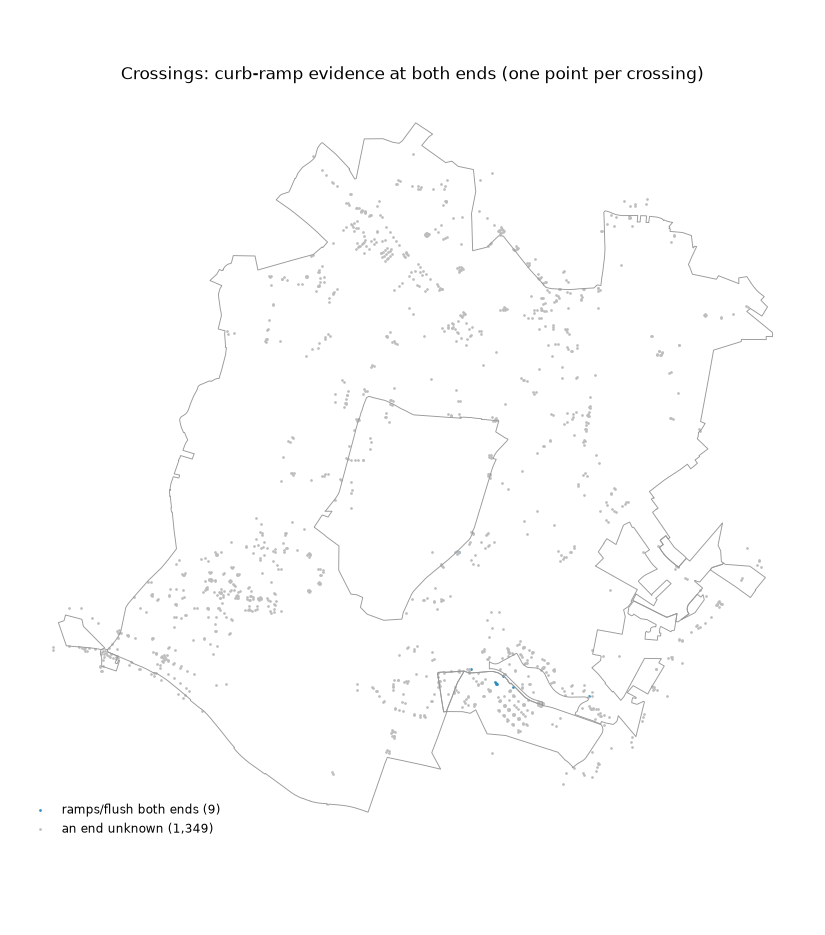
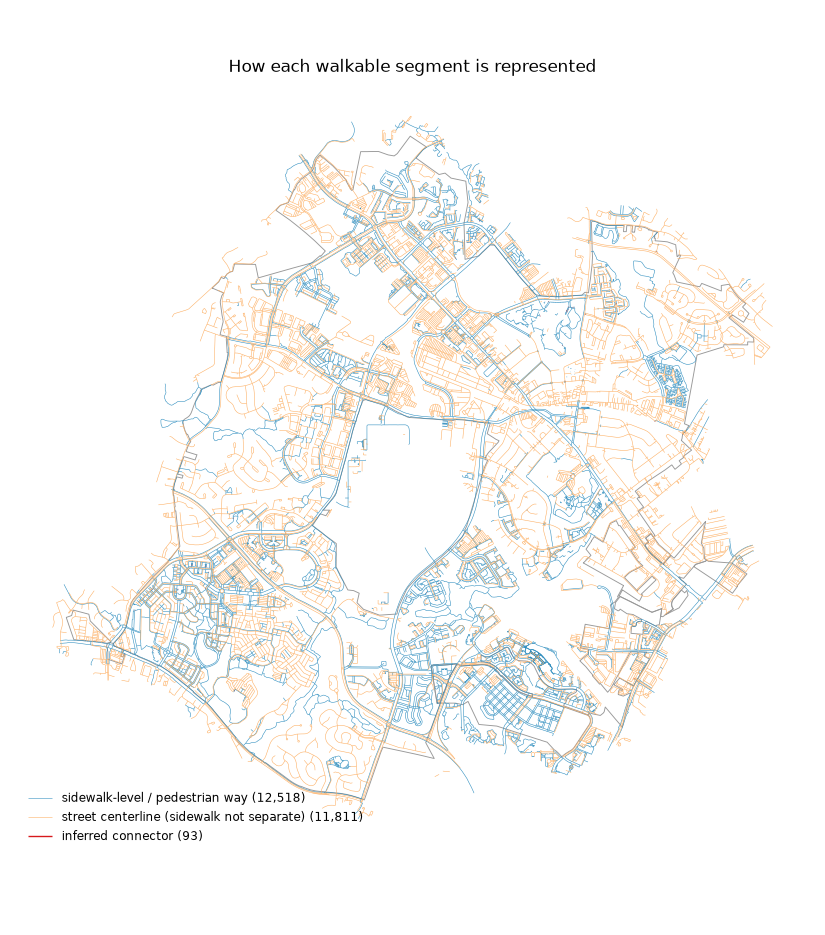
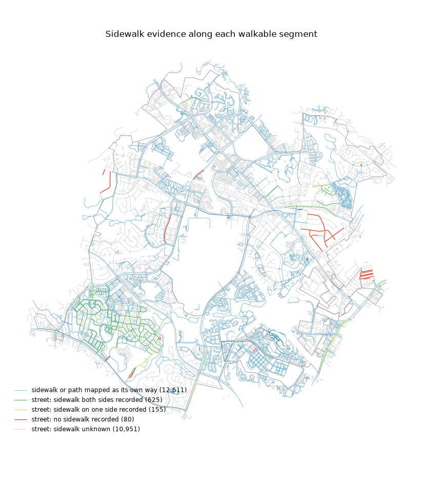

# Phase 0 — Data coverage report: Gaithersburg, MD

_Generated by `pf coverage` from the graph built on OSM extract dated Thu, 15 Oct 2026 03:56:57 GMT. Do not edit by hand._

Sources beyond OSM and the boundary: report_districts = `gaithersburg_tracts`; dtm = `gaithersburg_dtm`. An attribute with no source stays unknown; absence of a record counts as evidence only where an inventory covers the place (planimetric: None, signals: None).

Status meanings: **verified** = directly observed by a source (incl. confirmed absence in an inventory comprehensive for that place); **inferred** = produced by a documented heuristic; **unknown** = no evidence. Unknown is never treated as favorable.

## Network

- Walkable edges: **24,422**, nodes: **18,450**
- Largest connected component holds **97.9%** of walkable length (102 components in total; the rest are mostly private-lot service roads)
- Length by representation (km): {'inferred_connector': 0.2, 'pedestrian_way': 407.2, 'street_centerline': 565.8} — sidewalk-level share of length: **41.8%**
- Removed-road stubs pruned: 542; inferred gap connectors: 93 (each disclosed as `inferred_connector`), of which 0 bridge a wider gap across planimetric sidewalk surface
- Pedestrian dead ends left unbridged: 1,297 lie within 15 m of another walkway with no evidence of a connection (near is not connected)

## Accessibility bar (criteria 1, 2, 3, 5; criterion 4 is in crux.md)

Inside the region's line. Fixed on 2026-10-15 before any accessibility source was loaded.

| criterion | value_pct | bar_pct | result | counts |
|---|---|---|---|---|
| 1. Curb evidence at crossing ends, implicit included | 18.9 | 60.0 | misses | 1,226 of 6,498 ends |
| 2. Slope verified, share of walkable length | 89.4 | 80.0 | passes |  |
| 3. Sidewalk evidence, share of walkable length | 47.2 | 60.0 | misses | sidewalk-level ways 42.7%, streets with presence recorded 4.5% (of which a sidewalk on at least one side only: 0.0%) |
| 5. Main component, share of length (whole graph) | 97.9 | 90.0 | passes |  |

## Attribute coverage

| attribute | scope | weighted_by | n | verified | inferred | unknown | top_sources | evidence_year_median | evidence_year_range |
|---|---|---|---|---|---|---|---|---|---|
| crossing_control | crossings | count | 1358 | 73.0 | 25.8 | 1.2 | osm_gaithersburg 74%; derived:osm_marked_no_signal_inventory 26%; derived:osm_signal_tags_conflict 0% | 2,026 | 2026–2026 |
| signal_lpi | signalized crossings | count | 177 | 0.0 | 0.0 | 100 |  |  |  |
| signal_aps | signalized crossings | count | 177 | 0.0 | 0.0 | 100 |  |  |  |
| signal_hawk | signalized crossings | count | 177 | 0.0 | 0.0 | 100 |  |  |  |
| signal_all_ped_phase | signalized crossings | count | 177 | 0.0 | 0.0 | 100 |  |  |  |
| crossed_lanes | crossings | count | 1358 | 28.0 | 0.0 | 72.0 | osm_gaithersburg 100% | 2,026 | 2026–2026 |
| crossed_width_m | crossings | count | 1358 | 0.0 | 0.0 | 100 |  |  |  |
| crossed_speed_mph | crossings | count | 1358 | 18.0 | 0.0 | 82.0 | osm_gaithersburg 100% | 2,026 | 2026–2026 |
| crossed_aadt | crossings | count | 1358 | 0.0 | 0.0 | 100 |  |  |  |
| kerb_a | crossings | count | 1358 | 1.0 | 0.0 | 99.0 | osm_gaithersburg 100% | 2,026 | 2026–2026 |
| kerb_b | crossings | count | 1358 | 1.5 | 0.0 | 98.5 | osm_gaithersburg 100% | 2,026 | 2026–2026 |
| ramp_check_a | crossings | count | 1358 | 0.0 | 0.0 | 100 |  |  |  |
| ramp_check_b | crossings | count | 1358 | 0.0 | 0.0 | 100 |  |  |  |
| step_free | all edges | length | 24422 | 0.1 | 99.9 | 0.0 | derived:absent_from_osm_steps_outside_inventory 77%; derived:absent_from_osm_steps_offstreet 22%; osm_gaithersburg 0% | 2,026 | 2026–2026 |
| grade_avg_pct | all edges | length | 24422 | 89.4 | 10.4 | 0.2 | gaithersburg_dtm 98%; derived:gaithersburg_dtm_endpoints 2% | 2,020 | 2020–2020 |
| grade_max_pct | all edges | length | 24422 | 89.4 | 10.4 | 0.2 | gaithersburg_dtm 98%; derived:gaithersburg_dtm_endpoints 2% | 2,020 | 2020–2020 |
| surface_class | pedestrian ways | length | 12518 | 81.3 | 0.0 | 18.7 | osm_gaithersburg 100% | 2,026 | 2026–2026 |
| sidewalk_presence | street centerlines | length | 11811 | 7.2 | 0.0 | 92.8 | osm_gaithersburg 100% | 2,026 | 2026–2026 |
| sidewalk_condition | sidewalks | length | 6058 | 0.0 | 0.0 | 100 |  |  |  |
| sidewalk_width_m | sidewalks | length | 6058 | 0.0 | 0.0 | 100 |  |  |  |
| street_lanes | street centerlines | length | 11811 | 18.9 | 0.0 | 81.1 | osm_gaithersburg 100% | 2,026 | 2026–2026 |
| street_speed_mph | street centerlines | length | 11811 | 13.5 | 0.0 | 86.5 | osm_gaithersburg 100% | 2,026 | 2026–2026 |

## By census tract

| ward | network_km | sidewalk_level_share_pct | crossings | crossings_both_kerbs_known_pct | crossings_control_known_pct | centerline_sidewalk_known_pct | grade_known_pct |
|---|---|---|---|---|---|---|---|
| 24031700604 | 10.3 | 24.5 | 17 | 0.0 | 76.5 | 0.0 | 100 |
| 24031700606 | 2.0 | 4.5 | 0 |  |  | 0.0 | 100 |
| 24031700610 | 9.4 | 41.9 | 0 |  |  | 13.4 | 100 |
| 24031700616 | 12.2 | 25.1 | 32 | 0.0 | 100 | 1.7 | 100 |
| 24031700617 | 1.7 | 14.9 | 0 |  |  | 1.4 | 100 |
| 24031700706 | 67.7 | 35.3 | 76 | 0.0 | 100 | 0.9 | 99.2 |
| 24031700711 | 3.7 | 24.0 | 1 | 0.0 | 100 | 0.0 | 100 |
| 24031700713 | 25.5 | 37.0 | 67 | 0.0 | 100 | 0.0 | 100 |
| 24031700715 | 2.8 | 44.7 | 6 | 0.0 | 100 | 0.0 | 100 |
| 24031700718 | 37.8 | 31.3 | 35 | 0.0 | 97.1 | 9.6 | 99.6 |
| 24031700720 | 22.3 | 19.9 | 11 | 0.0 | 100 | 2.0 | 100 |
| 24031700721 | 10.8 | 63.2 | 9 | 0.0 | 100 | 0.0 | 99.7 |
| 24031700723 | 58.3 | 33.5 | 104 | 0.0 | 98.1 | 1.6 | 99.9 |
| 24031700724 | 19.7 | 31.4 | 24 | 0.0 | 100 | 0.5 | 100 |
| 24031700725 | 18.2 | 6.8 | 11 | 0.0 | 100 | 19.1 | 100 |
| 24031700726 | 27.1 | 57.3 | 14 | 0.0 | 100 | 0.1 | 100 |
| 24031700727 | 12.6 | 17.0 | 9 | 0.0 | 100 | 29.1 | 100 |
| 24031700728 | 27.4 | 14.4 | 16 | 0.0 | 100 | 11.5 | 100 |
| 24031700729 | 10.6 | 24.4 | 13 | 0.0 | 100 | 0.0 | 100 |
| 24031700730 | 1.3 | 0.0 | 0 |  |  | 0.0 | 100 |
| 24031700731 | 34.5 | 44.3 | 56 | 0.0 | 100 | 0.3 | 99.7 |
| 24031700732 | 28.6 | 29.7 | 26 | 0.0 | 100 | 0.0 | 99.9 |
| 24031700733 | 89.0 | 40.6 | 152 | 0.0 | 99.3 | 1.0 | 99.4 |
| 24031700812 | 0.9 | 6.0 | 2 | 0.0 | 100 | 0.0 | 100 |
| 24031700813 | 6.2 | 52.5 | 0 |  |  | 0.0 | 99.9 |
| 24031700820 | 15.5 | 6.3 | 5 | 0.0 | 100 | 0.0 | 100 |
| 24031700822 | 25.9 | 36.7 | 31 | 0.0 | 100 | 4.0 | 99.9 |
| 24031700823 | 29.8 | 30.2 | 10 | 0.0 | 80.0 | 0.0 | 100 |
| 24031700824 | 44.8 | 61.1 | 95 | 0.0 | 100 | 46.8 | 99.9 |
| 24031700826 | 79.2 | 45.3 | 133 | 0.0 | 99.2 | 36.7 | 99.8 |
| 24031700828 | 23.0 | 31.3 | 8 | 0.0 | 100 | 5.5 | 100 |
| 24031700829 | 60.9 | 49.0 | 115 | 0.0 | 100 | 2.3 | 99.9 |
| 24031700832 | 0.1 | 100 | 0 |  |  |  | 100 |
| 24031700833 | 0.3 | 32.7 | 0 |  |  | 0.0 | 100 |
| 24031700836 | 15.9 | 72.0 | 28 | 0.0 | 100 | 0.0 | 100 |
| 24031700837 | 52.7 | 69.1 | 71 | 1.4 | 100 | 0.0 | 99.9 |
| 24031700838 | 21.0 | 61.0 | 15 | 0.0 | 100 | 0.0 | 99.8 |
| 24031700839 | 62.1 | 70.1 | 212 | 3.8 | 97.6 | 0.5 | 99.5 |
| 24031701007 | 1.3 | 18.6 | 1 | 0.0 | 100 | 0.0 | 94.8 |

## Each attribute by census tract: % of its scope with any evidence (verified or inferred)

Verified / inferred / unknown shares per census tract are in `coverage_attributes_by_census tract.csv`.

| attribute | census tract 24031700604 | census tract 24031700606 | census tract 24031700610 | census tract 24031700616 | census tract 24031700617 | census tract 24031700706 | census tract 24031700711 | census tract 24031700713 | census tract 24031700715 | census tract 24031700718 | census tract 24031700720 | census tract 24031700721 | census tract 24031700723 | census tract 24031700724 | census tract 24031700725 | census tract 24031700726 | census tract 24031700727 | census tract 24031700728 | census tract 24031700729 | census tract 24031700730 | census tract 24031700731 | census tract 24031700732 | census tract 24031700733 | census tract 24031700812 | census tract 24031700813 | census tract 24031700820 | census tract 24031700822 | census tract 24031700823 | census tract 24031700824 | census tract 24031700826 | census tract 24031700828 | census tract 24031700829 | census tract 24031700832 | census tract 24031700833 | census tract 24031700836 | census tract 24031700837 | census tract 24031700838 | census tract 24031700839 | census tract 24031701007 |
|---|---|---|---|---|---|---|---|---|---|---|---|---|---|---|---|---|---|---|---|---|---|---|---|---|---|---|---|---|---|---|---|---|---|---|---|---|---|---|---|
| crossing_control | 76.5 | 100 | 100 | 100 | 100 | 100 | 100 | 100 | 100 | 97.1 | 100 | 100 | 98.1 | 100 | 100 | 100 | 100 | 100 | 100 | 100 | 100 | 100 | 99.3 | 100 | 100 | 100 | 100 | 80.0 | 100 | 99.2 | 100 | 100 | 100 | 100 | 100 | 100 | 100 | 97.6 | 100 |
| signal_lpi | 0.0 | 100 | 100 | 0.0 | 100 | 0.0 | 100 | 0.0 | 100 | 0.0 | 100 | 0.0 | 0.0 | 0.0 | 0.0 | 0.0 | 0.0 | 0.0 | 100 | 100 | 0.0 | 0.0 | 0.0 | 100 | 100 | 0.0 | 0.0 | 0.0 | 0.0 | 0.0 | 0.0 | 0.0 | 100 | 100 | 0.0 | 0.0 | 0.0 | 0.0 | 100 |
| signal_aps | 0.0 | 100 | 100 | 0.0 | 100 | 0.0 | 100 | 0.0 | 100 | 0.0 | 100 | 0.0 | 0.0 | 0.0 | 0.0 | 0.0 | 0.0 | 0.0 | 100 | 100 | 0.0 | 0.0 | 0.0 | 100 | 100 | 0.0 | 0.0 | 0.0 | 0.0 | 0.0 | 0.0 | 0.0 | 100 | 100 | 0.0 | 0.0 | 0.0 | 0.0 | 100 |
| signal_hawk | 0.0 | 100 | 100 | 0.0 | 100 | 0.0 | 100 | 0.0 | 100 | 0.0 | 100 | 0.0 | 0.0 | 0.0 | 0.0 | 0.0 | 0.0 | 0.0 | 100 | 100 | 0.0 | 0.0 | 0.0 | 100 | 100 | 0.0 | 0.0 | 0.0 | 0.0 | 0.0 | 0.0 | 0.0 | 100 | 100 | 0.0 | 0.0 | 0.0 | 0.0 | 100 |
| signal_all_ped_phase | 0.0 | 100 | 100 | 0.0 | 100 | 0.0 | 100 | 0.0 | 100 | 0.0 | 100 | 0.0 | 0.0 | 0.0 | 0.0 | 0.0 | 0.0 | 0.0 | 100 | 100 | 0.0 | 0.0 | 0.0 | 100 | 100 | 0.0 | 0.0 | 0.0 | 0.0 | 0.0 | 0.0 | 0.0 | 100 | 100 | 0.0 | 0.0 | 0.0 | 0.0 | 100 |
| crossed_lanes | 23.5 | 100 | 100 | 25.0 | 100 | 28.9 | 0.0 | 49.3 | 0.0 | 51.4 | 54.5 | 44.4 | 26.0 | 79.2 | 18.2 | 21.4 | 11.1 | 43.8 | 7.7 | 100 | 14.3 | 15.4 | 11.8 | 100 | 100 | 60.0 | 12.9 | 30.0 | 72.6 | 51.1 | 62.5 | 20.9 | 100 | 100 | 39.3 | 22.5 | 26.7 | 13.2 | 0.0 |
| crossed_width_m | 0.0 | 100 | 100 | 0.0 | 100 | 0.0 | 0.0 | 0.0 | 0.0 | 0.0 | 0.0 | 0.0 | 0.0 | 0.0 | 0.0 | 0.0 | 0.0 | 0.0 | 0.0 | 100 | 0.0 | 0.0 | 0.0 | 0.0 | 100 | 0.0 | 0.0 | 0.0 | 0.0 | 0.0 | 0.0 | 0.0 | 100 | 100 | 0.0 | 0.0 | 0.0 | 0.0 | 0.0 |
| crossed_speed_mph | 17.6 | 100 | 100 | 21.9 | 100 | 5.3 | 0.0 | 3.0 | 0.0 | 34.3 | 45.5 | 0.0 | 9.6 | 33.3 | 9.1 | 0.0 | 0.0 | 31.2 | 0.0 | 100 | 3.6 | 7.7 | 3.3 | 0.0 | 100 | 60.0 | 19.4 | 10.0 | 70.5 | 48.9 | 62.5 | 12.2 | 100 | 100 | 35.7 | 21.1 | 20.0 | 9.0 | 0.0 |
| crossed_aadt | 0.0 | 100 | 100 | 0.0 | 100 | 0.0 | 0.0 | 0.0 | 0.0 | 0.0 | 0.0 | 0.0 | 0.0 | 0.0 | 0.0 | 0.0 | 0.0 | 0.0 | 0.0 | 100 | 0.0 | 0.0 | 0.0 | 0.0 | 100 | 0.0 | 0.0 | 0.0 | 0.0 | 0.0 | 0.0 | 0.0 | 100 | 100 | 0.0 | 0.0 | 0.0 | 0.0 | 0.0 |
| kerb_a | 0.0 | 100 | 100 | 0.0 | 100 | 0.0 | 0.0 | 0.0 | 0.0 | 0.0 | 0.0 | 0.0 | 0.0 | 0.0 | 0.0 | 0.0 | 0.0 | 0.0 | 0.0 | 100 | 0.0 | 0.0 | 0.0 | 0.0 | 100 | 0.0 | 0.0 | 0.0 | 0.0 | 0.0 | 0.0 | 0.0 | 100 | 100 | 0.0 | 2.8 | 0.0 | 5.2 | 0.0 |
| kerb_b | 0.0 | 100 | 100 | 0.0 | 100 | 0.0 | 0.0 | 0.0 | 0.0 | 0.0 | 0.0 | 0.0 | 0.0 | 0.0 | 0.0 | 0.0 | 0.0 | 0.0 | 0.0 | 100 | 1.8 | 0.0 | 1.3 | 0.0 | 100 | 0.0 | 0.0 | 0.0 | 0.0 | 0.0 | 0.0 | 0.0 | 100 | 100 | 0.0 | 2.8 | 0.0 | 7.1 | 0.0 |
| ramp_check_a | 0.0 | 100 | 100 | 0.0 | 100 | 0.0 | 0.0 | 0.0 | 0.0 | 0.0 | 0.0 | 0.0 | 0.0 | 0.0 | 0.0 | 0.0 | 0.0 | 0.0 | 0.0 | 100 | 0.0 | 0.0 | 0.0 | 0.0 | 100 | 0.0 | 0.0 | 0.0 | 0.0 | 0.0 | 0.0 | 0.0 | 100 | 100 | 0.0 | 0.0 | 0.0 | 0.0 | 0.0 |
| ramp_check_b | 0.0 | 100 | 100 | 0.0 | 100 | 0.0 | 0.0 | 0.0 | 0.0 | 0.0 | 0.0 | 0.0 | 0.0 | 0.0 | 0.0 | 0.0 | 0.0 | 0.0 | 0.0 | 100 | 0.0 | 0.0 | 0.0 | 0.0 | 100 | 0.0 | 0.0 | 0.0 | 0.0 | 0.0 | 0.0 | 0.0 | 100 | 100 | 0.0 | 0.0 | 0.0 | 0.0 | 0.0 |
| step_free | 100 | 100 | 100 | 100 | 100 | 100 | 100 | 100 | 100 | 100 | 100 | 100 | 100 | 100 | 100 | 100 | 100 | 100 | 100 | 100 | 100 | 100 | 100 | 100 | 100 | 100 | 100 | 100 | 100 | 100 | 100 | 100 | 100 | 100 | 100 | 100 | 100 | 100 | 100 |
| grade_avg_pct | 100 | 100 | 100 | 100 | 100 | 99.2 | 100 | 100 | 100 | 99.6 | 100 | 99.7 | 99.9 | 100 | 100 | 100 | 100 | 100 | 100 | 100 | 99.7 | 99.9 | 99.4 | 100 | 99.9 | 100 | 99.9 | 100 | 99.9 | 99.8 | 100 | 99.9 | 100 | 100 | 100 | 99.9 | 99.8 | 99.5 | 94.8 |
| grade_max_pct | 100 | 100 | 100 | 100 | 100 | 99.2 | 100 | 100 | 100 | 99.6 | 100 | 99.7 | 99.9 | 100 | 100 | 100 | 100 | 100 | 100 | 100 | 99.7 | 99.9 | 99.4 | 100 | 99.9 | 100 | 99.9 | 100 | 99.9 | 99.8 | 100 | 99.9 | 100 | 100 | 100 | 99.9 | 99.8 | 99.5 | 94.8 |
| surface_class | 1.5 | 100 | 49.9 | 22.0 | 83.2 | 89.3 | 46.6 | 63.1 | 0.0 | 82.9 | 65.7 | 99.8 | 61.7 | 55.7 | 36.9 | 92.4 | 24.2 | 44.1 | 51.1 | 100 | 67.4 | 82.2 | 92.7 | 0.0 | 71.8 | 8.6 | 23.6 | 40.4 | 92.9 | 90.7 | 96.6 | 76.9 | 100 | 100 | 96.4 | 97.1 | 98.0 | 94.2 | 3.1 |
| sidewalk_presence | 0.0 | 0.0 | 13.4 | 1.7 | 1.4 | 0.9 | 0.0 | 0.0 | 0.0 | 9.6 | 2.0 | 0.0 | 1.6 | 0.5 | 19.1 | 0.1 | 29.1 | 11.5 | 0.0 | 0.0 | 0.3 | 0.0 | 1.0 | 0.0 | 0.0 | 0.0 | 4.0 | 0.0 | 46.8 | 36.7 | 5.5 | 2.3 | 100 | 0.0 | 0.0 | 0.0 | 0.0 | 0.5 | 0.0 |
| sidewalk_condition | 0.0 | 100 | 0.0 | 0.0 | 0.0 | 0.0 | 0.0 | 0.0 | 0.0 | 0.0 | 0.0 | 0.0 | 0.0 | 0.0 | 0.0 | 0.0 | 0.0 | 0.0 | 0.0 | 100 | 0.0 | 0.0 | 0.0 | 0.0 | 0.0 | 0.0 | 0.0 | 0.0 | 0.0 | 0.0 | 0.0 | 0.0 | 100 | 0.0 | 0.0 | 0.0 | 0.0 | 0.0 | 0.0 |
| sidewalk_width_m | 0.0 | 100 | 0.0 | 0.0 | 0.0 | 0.0 | 0.0 | 0.0 | 0.0 | 0.0 | 0.0 | 0.0 | 0.0 | 0.0 | 0.0 | 0.0 | 0.0 | 0.0 | 0.0 | 100 | 0.0 | 0.0 | 0.0 | 0.0 | 0.0 | 0.0 | 0.0 | 0.0 | 0.0 | 0.0 | 0.0 | 0.0 | 100 | 0.0 | 0.0 | 0.0 | 0.0 | 0.0 | 0.0 |
| street_lanes | 5.0 | 86.7 | 15.3 | 11.1 | 30.6 | 19.1 | 24.1 | 10.3 | 27.4 | 12.4 | 27.9 | 3.2 | 17.7 | 10.7 | 9.0 | 4.1 | 10.6 | 16.4 | 39.7 | 0.0 | 9.1 | 14.5 | 13.4 | 68.3 | 6.0 | 5.0 | 2.9 | 10.7 | 59.4 | 40.0 | 21.4 | 28.3 | 100 | 100 | 59.6 | 5.3 | 25.5 | 13.1 | 60.0 |
| street_speed_mph | 20.4 | 79.6 | 10.0 | 8.3 | 30.6 | 4.3 | 16.4 | 2.7 | 6.8 | 10.7 | 13.2 | 0.0 | 10.9 | 6.2 | 6.4 | 0.0 | 0.6 | 11.5 | 0.0 | 0.0 | 13.3 | 6.4 | 4.8 | 24.2 | 12.7 | 3.3 | 10.8 | 9.4 | 53.7 | 39.8 | 23.7 | 19.8 | 100 | 0.0 | 53.5 | 9.2 | 20.2 | 3.9 | 49.9 |

## Cross-source conflicts and quality flags

- `osm_signal_without_signal_inventory_within_40m`: 175
- `osm_unsignalized_with_signal_inventory_within_40m`: 0
- `osm_marked_signalization_not_recorded_with_signal_inventory_within_40m`: 0
- `osm_signal_tags_contradict_each_other`: 5
- `crossings_marked_in_osm_without_planimetric_crosswalk`: n/a (no source records it)
- `unmapped_stairs_found_via_planimetrics`: 0
- `kerb_evidence_from_project_sidewalk_pre_2018`: 0
- `grade_readings_downgraded_suspect`: 113
- `grade_readings_downgraded_not_repeatable`: 1,550
- `edges_with_grade_separation_masking`: 85
- `implicit_crossing_edge_ends`: 5,261
- `implicit_crossing_ends_with_unknown_kerb`: 3,734
- `edges_outside_region_inventory_coverage_on_street`: 3,553
- `grade_readings_discarded_dtm_discontinuity`: 12

## Maps

