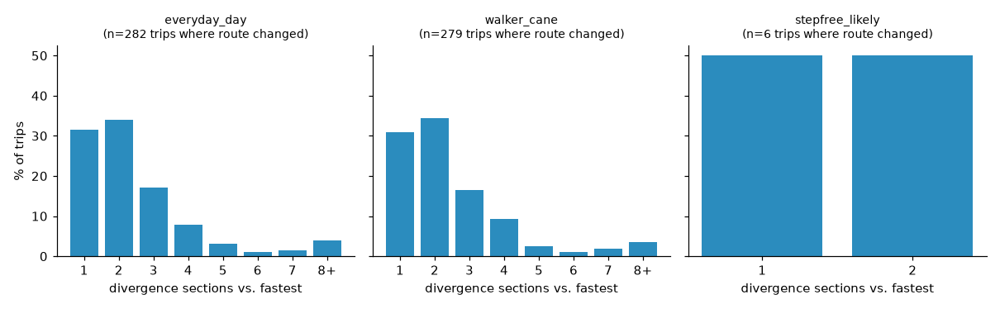

# Phase 0 — Crux hypothesis experiment

_Generated by `pf crux` / `write_report`. Do not edit by hand._

**Design.** 300 origin–destination pairs sampled citywide (length-weighted origins on walkable edges; destinations stratified into 400–800 m, 800–1,500 m and 1,500–2,500 m straight-line bands; seed 20261004). The pairs are a fixed list of coordinates (`crux_od_pairs.csv`, 300 pairs) placed on the current network, so runs on different graph versions walk the same trips; pairs with an end more than 30 m from the network, or whose two ends now share a node, are left out. Each pair is routed under six profiles. For each, the route recommended for the profile's priorities (equal weights unless noted) is compared with the fastest route that satisfies the same requirements.

**H1:** when the recommended route differs from the fastest, they differ in ≤ 3 places (divergence sections) for most trips.

**Caveat.** Recommendations depend on the v8 penalty tables (`routing/cost.py`), which are product judgments, not measurements. `everyday_day_x2` doubles their intensity as a sensitivity check. These results test whether the *interaction* is viable on the region's real network; they say nothing about whether routes are safer.

| profile | feasible % | route changed % | H1: ≤3 sections % (when changed) | extra min p50 / p90 | median routes in set | latency p50 / p95 s |
|---|---|---|---|---|---|---|
| everyday_day | 100.0 | 94.0 | 82.6 | 1.14 / 3.79 | 12.0 | 0.027 / 0.14 |
| everyday_day_x2 | 100.0 | 95.7 | 80.1 | 1.56 / 4.37 | 13.0 | 0.029 / 0.172 |
| stepfree_likely | 2.7 | 75.0 | 100.0 | 0.09 / 1.41 | 8.5 | 0.016 / 0.037 |
| stepfree_unknown_ok | 70.7 | 96.7 | 79.0 | 1.02 / 3.54 | 10.0 | 0.024 / 0.119 |
| stepfree_verified | 0.0 | nan | — | — / — | None | None / None |
| walker_cane | 100.0 | 93.0 | 81.7 | 1.15 / 3.72 | 12.0 | 0.025 / 0.13 |

## H1 by distance band (everyday_day)

| band (m) | trips where route changed | ≤3 sections % | median sections |
|---|---|---|---|
| 400-800 | 84 | 95.2 | 2.0 |
| 800-1500 | 98 | 88.8 | 2.0 |
| 1500-2500 | 100 | 66.0 | 3.0 |

## Is the difference worth showing?

A recommendation that is felt to be less than 30 s better than the fastest route (at the profile's own priorities) is not offered as a separate choice (`routing/explain.py`).

| profile | worth showing, % of feasible trips | % of changed routes | H1: ≤3 sections % (when worth showing) | felt gain min p50 (when changed) |
|---|---|---|---|---|
| everyday_day | 91.0 | 96.8 | 82.1 | 8.12 |
| everyday_day_x2 | 94.0 | 98.3 | 79.8 | 17.08 |
| stepfree_likely | 50.0 | 66.7 | 100.0 | 0.75 |
| stepfree_unknown_ok | 95.3 | 98.5 | 78.7 | 8.68 |
| stepfree_verified | — | — | — | — |
| walker_cane | 91.0 | 97.8 | 81.3 | 8.89 |

## Network circuity (fastest route length / straight-line distance)

- median 1.444, p95 3.853, trips with circuity > 2: 55 (candidates for missing links or real barriers such as rail yards, freeways and rivers)

## Step-free feasibility

Requirement: step-free + max sustained grade 8.33 %. Infeasible trips under `allow_likely` were re-run with single relaxations to find what blocks them:

- `allow_unknown`: 199
- `none_single`: 82
- `drop_max_grade`: 5
- `drop_max_grade,allow_unknown`: 3
- `drop_max_grade,allow_unknown,grade_12pct`: 2
- `drop_max_grade,grade_12pct`: 1
